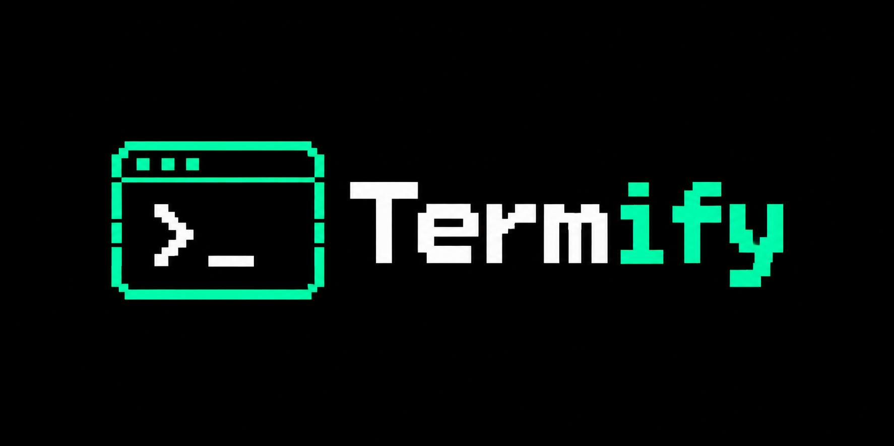
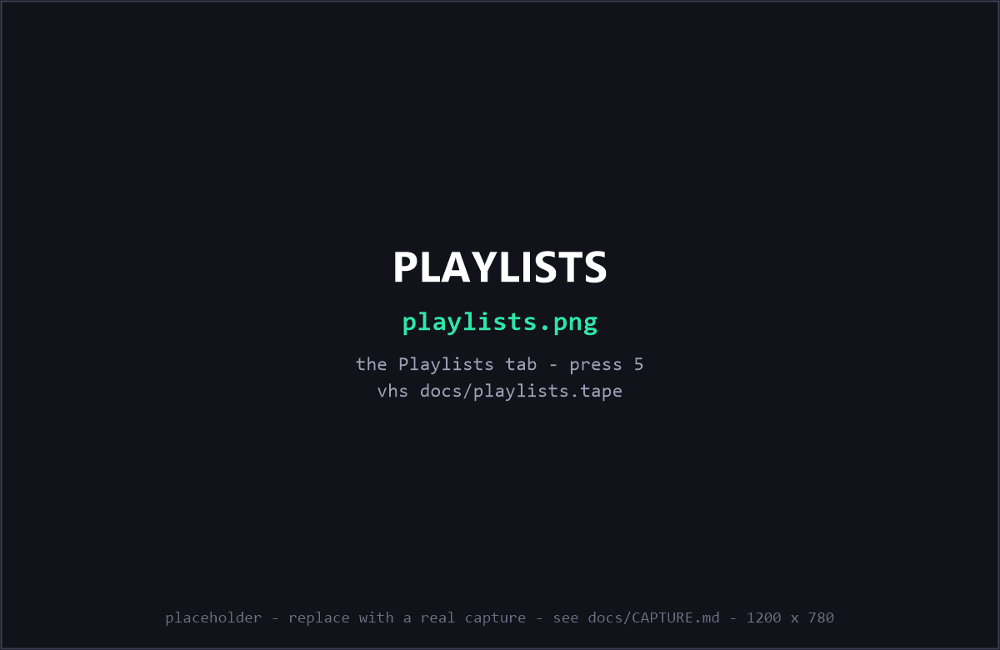
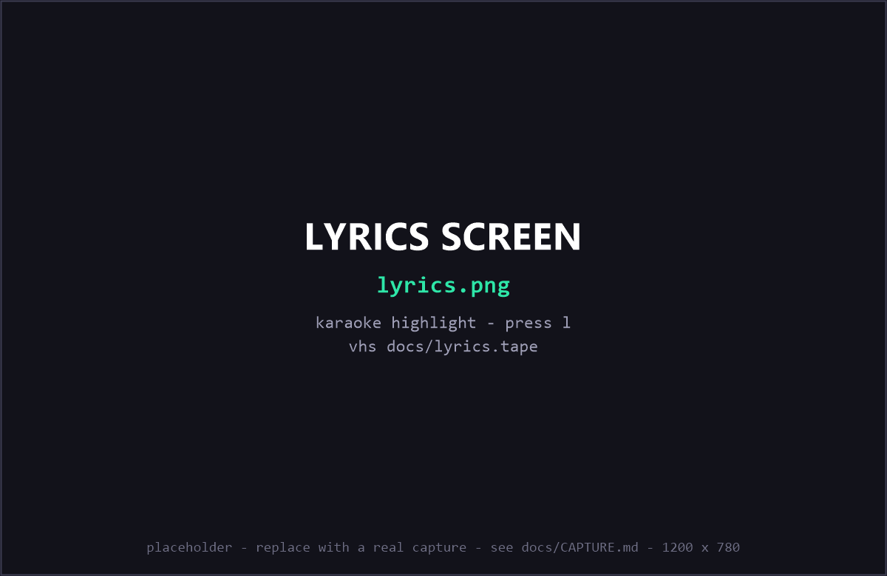
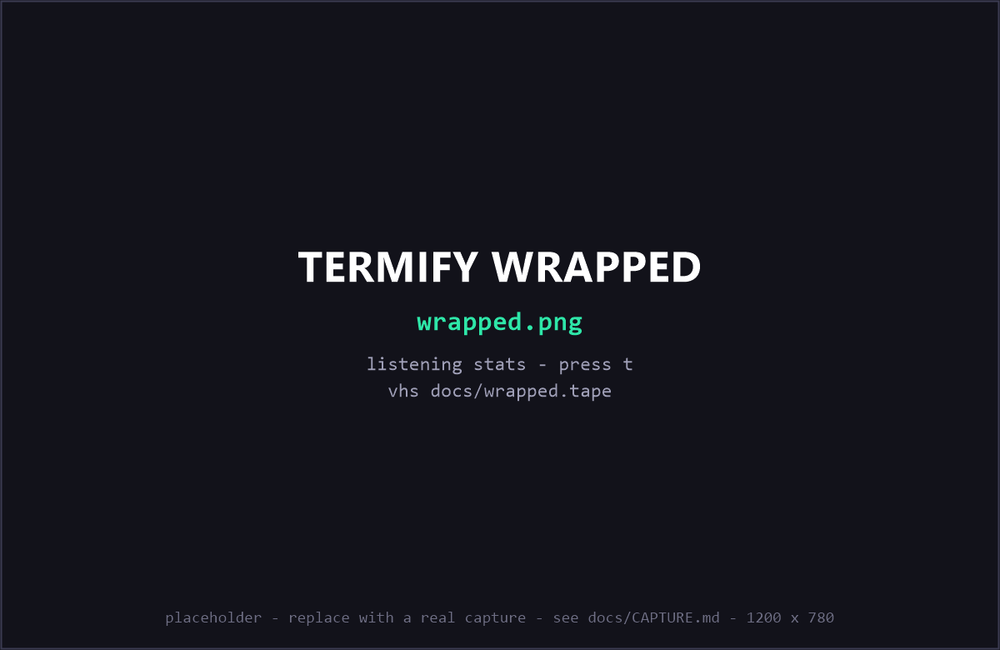
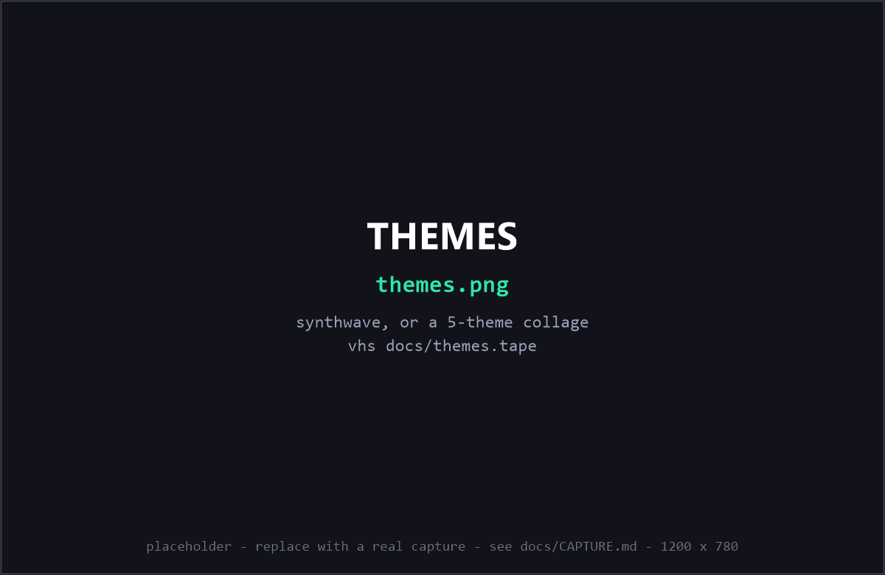

# Termify — Spotify, but in your terminal

<p align="center">
    
</p>

<p align="center">
    <a href="https://www.npmjs.com/package/termify-app">NPM</a> | <a href="#controls">Controls</a>
</p>

A Spotify-style music player that lives in your terminal. Search any song and press play 
audio streams instantly through **yt-dlp + ffmpeg + PortAudio**.

- ❌ No Spotify account, no API keys, no tokens — nothing from Spotify
- ❌ No ads in the stream (audio-only playback skips them entirely)
- ✅ Free forever, open code


> Not affiliated with Spotify, YouTube or Google. For personal use — respect the
> copyright of what you listen to.

<p align="center">
  
  <br>
  <em>Search any song, press <code>Enter</code> — it plays instantly, with a live visualizer and mood tag in the now-playing bar.</em>
</p>

## Quick start

**npm — Windows / macOS / Linux:**

```bash
npm i termify-app     # registers the `termify` command
termify               # first launch finishes the setup automatically
```

The npm package keeps its own private Python environment in `~/.termify/venv`
(you just need Python 3.10+ installed somewhere) and stores your library in
`~/.termify/data`, so updates never touch your likes, playlists or downloads.
Recent npm versions skip install scripts by default — that's fine, the first
`termify` run sets everything up itself. `npx termify-app` works too.

**Windows (from source):** double-click `run.bat` (the first run installs its own little world inside
`.venv/`, about a minute; later runs start instantly).

**macOS / Linux (from source):**

```bash
chmod +x run.sh && ./run.sh    # or: bash run.sh
```

- Needs Python 3.10+. On Debian/Ubuntu, a virtualenv also needs
  `sudo apt install python3-venv`.
- On Linux the audio library comes from your distro:
  `sudo apt install libportaudio2` (Fedora/Arch: `portaudio`).
  macOS needs nothing extra — PortAudio ships with the pip package.
- ffmpeg is bundled automatically on all three platforms, no system install needed.
- Works in any modern terminal (Terminal.app, iTerm2, GNOME Terminal, Kitty,
  Alacritty…). Under WSL, use Windows 11 with WSLg — or just use the Windows build.

**Manually** (Python 3.10+):

```bash
pip install -r requirements.txt
python -m termify            # or: python -m termify "lofi beats"
python -m termify --ascii    # force plain-text mode (old terminals)
```

Then inside the app: press `/`, type a song or artist, `Enter` to search, `Enter` again to play.

## Controls

| Key | Action |
| --- | --- |
| `/` | search (or paste a YouTube link) |
| `Enter` | play the selected track (in the Playlists tab: open a playlist) |
| `l` | lyrics screen — synced, karaoke-style highlighting when available |
| `t` | **stats** — Termify Wrapped: total hours, top songs, top artists |
| `R` | radio — queue more songs in the same mood as the current one |
| `A` | toggle autoplay (mood-matched music never stops) |
| `w` | **save offline** — download a track (whole playlist inside a playlist) |
| `x` | **export to mp3** — selection / playlist / all downloads |
| `i` | **import a playlist** from a text or CSV file |
| `e` | equalizer: flat · bass boost · night · vocal · club |
| `v` | toggle the live audio visualizer |
| `z` | sleep timer: 15/30/60 min · after this song · after the queue |
| `T` | cycle color theme (termify · synthwave · gruvbox · ocean · mono) |
| `u` | plain-text (ASCII) mode on/off |
| `N` / `M` | desktop notifications / mouse support on-off |
| `a` | add the selected track to a playlist (typing a new name creates it) |
| `c` | create a playlist (Playlists tab) |
| `d` | remove selected: track from queue/playlist/liked/recent/downloads; in Playlists: delete it (press twice) |
| `space` | pause / resume |
| `n` / `b` | next / previous track |
| `←` / `→` | seek 10 seconds back / forward |
| `+` / `−` | volume up / down (`m` mutes) |
| `f` | like / unlike the selected track |
| `s` / `r` | shuffle / repeat mode (off · queue · one) |
| `1`–`6` | tabs: Queue, Results, Liked, Recent, Playlists, Downloads |
| `j` `k` `g` `G` `PgUp` `PgDn` | move around the list |
| mouse | click a row to play it, click a tab, scroll the lists |
| `?` | help screen |
| `q` | quit |

## Playlists

Press `a` on any track and type a name — a new name creates the playlist, an
existing name adds the track to it. The `[5] Playlists` tab lists everything;
`Enter` opens one, `d` (twice) deletes it. Playlists are saved to
`data/playlists.json`.

<p align="center">
  
  <br>
  <em>The <code>[5] Playlists</code> tab — <code>Enter</code> opens a playlist, <code>a</code> adds the selected track, <code>d</code> twice deletes it.</em>
</p>

## Lyrics

Press `l` while a song plays for a full-screen lyrics view (press `l` or `Esc`
to go back). Lyrics come from [LRCLIB](https://lrclib.net) — free, no API key,
no account:

- When **synced** lyrics exist, the line you are hearing is highlighted in
  green and the view follows the song like karaoke.
- Otherwise the plain lyrics are shown and you scroll with `j`/`k` or
  `PgUp`/`PgDn`.
- Instrumentals are detected and labeled as such.

Termify cleans up messy YouTube titles ("Artist - Song (Official Video) [4K]")
and matches by name + duration, so it usually finds the right lyrics.

<p align="center">
  
  <br>
  <em>Synced lyrics from LRCLIB — the line you are hearing is highlighted, karaoke-style.</em>
</p>

## Radio & autoplay (mood matching)

Termify matches the vibe of what you are listening to, without any API or
machine learning:

- **`R`** — "more like this": asks YouTube's own mix algorithm for songs in the
  same style/genre and splices them in right after the current track.
- **Autoplay** (on by default, toggle with `A`) — when the queue is about to run
  out, Termify silently queues similar tracks, so the music never stops.
- A small keyword engine labels the vibe of a song (sad, romantic, chill, hype,
  workout, happy, focus…) — you'll see it in the now-playing bar — and is used
  as the fallback when YouTube's mix data is unavailable.

So if a sad song is playing, the next songs will be sad songs — until you
change the mood yourself.

Your likes, recently played, playlists and settings are saved as plain JSON in
`data/` (volume, shuffle, repeat and autoplay are remembered between runs).

## Offline listening & mp3 export

- **`w`** saves the selected track (or every track of a playlist) into `data/cache/`.
  Saved tracks play **instantly and offline** — the player uses the local file —
  and the `[6] Downloads` tab lists them (with a `⬇` marker in every list);
  `d` there removes a track from disk.
- **`x`** converts the selection (or a whole playlist / all downloads) to **mp3**
  using the bundled ffmpeg — files land in `data/exports/`, ready for any player.
- **`i`** imports a playlist from a file: one `Artist - Song` line each, or a CSV
  export (header rows like `Track Name,Artist Name` are understood). Termify
  resolves every line on YouTube in the background and builds the playlist.

## Listening stats — Termify Wrapped

Press `t` for your own wrapped: total listening time, plays and unique songs, plus
the top songs and artists of the last 7 days. Everything is computed from
`data/plays.jsonl`, a local log of what you played — no account, nothing leaves
your machine.

<p align="center">
  
  <br>
  <em>Termify Wrapped — total hours, plays, and the top songs and artists of the last 7 days.</em>
</p>

## Sound & screen

- **`e` — equalizer**: five live presets (flat, bass boost, night, vocal, club)
  applied inside the audio pipeline with a small FIR filter — no plugins.
- **`v` — visualizer**: a live spectrum strip under the now-playing bar, computed
  from the audio you are actually hearing.
- **`z` — sleep timer**: 15 / 30 / 60 minutes, after this song, or after the
  queue — with a countdown in the header. Perfect for falling asleep to lofi.

## Quality of life

- **Resume on start**: quit any time — Termify remembers the queue and the exact
  position; press `space` after reopening to continue where you left off.
- **Desktop notifications** (`N`): a native toast when the song changes
  (osascript on macOS, notify-send on Linux, tray balloon on Windows).
- **Mouse support** (`M`): click a row to play it, click tabs, scroll the lists.
- **Themes** (`T`): termify (default), synthwave, gruvbox, ocean, mono.
- **Plain-text mode** (`u` or `--ascii`): every glyph falls back to ASCII for
  terminals without Unicode — also auto-enabled when the console is not UTF-8.

<p align="center">
  
  <br>
  <em>Cycle five color themes with <code>T</code> — termify, synthwave, gruvbox, ocean, mono (shown: synthwave).</em>
</p>

## How it works

```
search ──► yt-dlp (scrapes YouTube, no API key)      likes/history ──► data/*.json
play  ──► yt-dlp resolves a direct audio URL ──► ffmpeg decodes to PCM ──► PortAudio (speakers)
radio ──► YouTube's own "mix" (RD playlist) + mood keywords ──► same-vibe queue
```

- **No API** — yt-dlp talks to YouTube exactly like the website does; there is no key, no
  developer console, no login.
- **No ads** — only the audio stream is played, so no video ads, no banners, no interruptions.
- Upcoming tracks are prefetched in the background, so `n`/auto-advance start fast.

## If something is wrong

Run the built-in doctor — it checks every layer (yt-dlp, ffmpeg, audio device, search,
stream resolve, decode):

```bash
.venv\Scripts\python.exe -m termify --diag     # Windows
.venv/bin/python -m termify --diag             # macOS/Linux
```

| Symptom | Fix |
| --- | --- |
| "Could not find an audio stream" | YouTube changed something: `termify --update-deps` (npm installs) or `pip install -U yt-dlp` (source installs) |
| No sound | `--diag` shows the device it will use; make sure Windows sound output is the right one |
| "PortAudio library not found" (Linux) | `sudo apt install libportaudio2` (or your distro's portaudio package), then re-run `./run.sh` |
| `run.bat` closes instantly | run it from `cmd` so you can read the error, or use the manual commands |
| `./run.sh` says "permission denied" | `bash run.sh` (or `chmod +x run.sh` once) |
| Weird glyphs in an old terminal | press `u` (plain-text mode) or start with `--ascii` |

## Tests (optional)

Headless — no sound, no network (everything is faked):

```bash
.venv\Scripts\python.exe tests\tui_smoke.py       # 44 checks: drives the whole UI
.venv\Scripts\python.exe tests\autoplay_flow.py   # radio + autoplay logic
.venv\Scripts\python.exe tests\resume_flow.py     # session save/restore + position resume
.venv\Scripts\python.exe tests\eq_unit.py         # equalizer DSP response + continuity
.venv\Scripts\python.exe tests\data_unit.py       # importer / stats / store round-trips
.venv\Scripts\python.exe tests\lyrics_unit.py     # lyrics parsing and title cleaning
```

These ones make sounds (run them one at a time):

```bash
.venv\Scripts\python.exe tests\player_stress.py   # concurrency regression (seek storms, skip)
.venv\Scripts\python.exe tests\player_engine.py   # quiet sine tone: play/pause/seek/end
.venv\Scripts\python.exe tests\live_playback.py   # streams ~6s of real music from YouTube
```

## Layout

```
termify/
  app.py       the terminal UI (prompt_toolkit), tabs, key bindings
  player.py    audio engine: ffmpeg ─► numpy EQ + volume ─► sounddevice
  yt.py        yt-dlp wrapper: search, stream resolution, related, downloads
  lyrics.py    LRCLIB client: synced (LRC) + plain lyrics, title cleanup
  moods.py     keyword-based vibe detection (sad / chill / hype / …)
  eq.py        FIR equalizer presets (pure numpy, no plugins)
  stats.py     play-log aggregation for the wrapped screen
  importer.py  text/CSV playlist parsing for `i`
  notify.py    desktop notifications: osascript / notify-send / tray balloon
  themes.py    color palettes and prompt_toolkit styles
  store.py     likes / playlists / downloads / play log / session / settings
  util.py      tiny formatting helpers
run.bat       one-click launcher + first-time setup (Windows)
run.sh        same for macOS / Linux
bin/          npm launcher: registers `termify` and builds its Python env
package.json  npm packaging (published as `termify-app`)
tests/        headless UI tests + real-audio tests
docs/         README screenshots + VHS capture tapes (see docs/CAPTURE.md)
```
